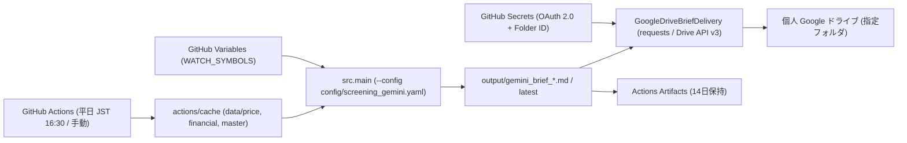

# フェーズ6 PR #2 詳細設計・運用ガイド: GitHub Actions 定期実行＆Google Drive API 直接アップロード

## 1. 概要と目的

手元 Mac がスリープ／オフラインの状態でも、平日大引け後に GitHub Actions 上で ProjectAtlas のスクリーニングパイプラインを自動実行し、生成された Gemini 連携ブリーフ（`gemini_brief_YYYY-MM-DD.md` / `gemini_brief_latest.md`）を個人 Google アカウントのマイドライブへ直接アップロードする（方式B）。

ローカル運用（方式A: `LocalCopyBriefDelivery`）や既存のレポート出力（`screening_report_*`）とは疎結合に保ち、`src/presentation/gemini_brief.py` の `BriefDeliveryBackend` プロトコルを実装する形で拡張する。

---

## 2. アーキテクチャと設計決定事項

### 2.1 Google Drive 認証・API 実装方針
- **認証方式**: **OAuth 2.0（Refresh Token 方式）**
  - 理由: Google Drive API の仕様上、サービスアカウントは個人マイドライブに対して保存容量（Storage Quota）を持たず新規ファイル作成が失敗するため。
- **実装ライブラリ**: **既存の `requests` で Drive REST API v3 を直接実装**
  - 理由: `requirements.txt`（現在 8 パッケージ）への推移的依存追加を避け、CI の高速性と既存テスト（`requests` モック）との統一性を維持するため。
- **同名ファイルの上書きルール**:
  1. `POST https://oauth2.googleapis.com/token` で `refresh_token` から `access_token` を取得。
  2. `GET https://www.googleapis.com/drive/v3/files` で指定フォルダ内の同名・未削除ファイル（`name = '...' and '<folder_id>' in parents and trashed = false`）を検索。
  3. 既存ファイルが見つかった場合は `PATCH https://www.googleapis.com/upload/drive/v3/files/{fileId}?uploadType=multipart` で上書き更新（ファイル ID を維持）。
  4. 見つからない場合は `POST https://www.googleapis.com/upload/drive/v3/files?uploadType=multipart` で新規作成。
  - ネットワーク一時エラー・429・5xx に対しては指数バックオフ付きリトライ（最大 3 回）を行う。

### 2.2 キャッシュ引き継ぎ方針（`actions/cache`）
- **対象ディレクトリ**: `data/price/`, `data/financial/`, `data/master/`（合計約 60MB）
  - ※ `data/cache/`（約 3.3GB）は評価用中間キャッシュのため除外する。
- **キー設計**:
  - `key: atlas-data-${{ github.run_id }}`
  - `restore-keys: |`
    `  atlas-data-`
- **挙動**: 平日毎日実行されるため通常は 7 日 TTL で失効せず直近キャッシュが復元される。初回実行時や長期連休（GW・年末年始等）明けでキャッシュが空・失効した場合は、ワークフロー側で `data/master/` が空なら自動で `--update-master` を付与し、さらに `run_full_pipeline` が事前スクリーニング前に IR BANK 財務キャッシュ（`warmup_irbank_cache`）を自動取得することでコールドスタート時の 0 銘柄化を防ぐ。

### 2.3 ワークフロー実行・監視銘柄（`watch_symbols`）・CLI オプション
- **実行スケジュール**:
  - `schedule`: `cron: '30 7 * * 1-5'`（平日 JST 16:30 頃＝東証 15:30 大引けおよびデータ反映後）
  - `workflow_dispatch`: 任意のタイミングで手動実行可能。以下の入力をサポートする:
    - `watch_symbols`: 継続監視する銘柄コード（空白・カンマ・読点区切り対応）
    - `as_of_date`: 分析基準日 `YYYY-MM-DD`（空欄時は直近完了営業日）
    - `update_master`: JPX 東証上場銘柄マスタの強制更新フラグ（`boolean`）
    - `skip_drive_upload`: Google Drive API アップロードをスキップするドライラン用フラグ（`boolean`）
- **CLI オプション連携（`src/main.py`）**:
  - `--brief-drive-folder-id`: Drive API 配信先フォルダ ID（優先順位: CLI 引数 ＞ `config` YAML `output.gemini_brief_drive_folder_id` ＞ 環境変数 `GOOGLE_DRIVE_FOLDER_ID`）。
  - `--strict-brief-delivery`: Google Drive API 等の外部配信や必須環境変数検証に失敗した際、警告ログのみで終わらせず終了コード `1` でパイプラインを失敗させるフラグ（GitHub Actions の `daily_gemini_brief.yml` で使用。この場合もローカルの `output/` 生成とキャッシュ保全・Artifacts アップロードは完了した状態で終了する）。
- **監視銘柄の優先順位**:
  1. `workflow_dispatch` の入力値（指定時）
  2. GitHub Repository Variables の `WATCH_SYMBOLS`（例: `7203.T,6758.T,8035.T` またはスペース区切り）
  3. `config/screening_gemini.yaml` の `output.watch_symbols`

---

## 3. GitHub Secrets / Variables 設定一覧

### 3.1 GitHub Secrets（リポジトリの `Settings > Secrets and variables > Actions > Secrets`）
| Secret 名 | 内容 |
|---|---|
| `GOOGLE_DRIVE_CLIENT_ID` | Google Cloud OAuth 2.0 クライアント ID |
| `GOOGLE_DRIVE_CLIENT_SECRET` | Google Cloud OAuth 2.0 クライアントシークレット |
| `GOOGLE_DRIVE_REFRESH_TOKEN` | Drive スコープ認可済みのリフレッシュトークン |
| `GOOGLE_DRIVE_FOLDER_ID` | アップロード先 Google ドライブフォルダの ID（URL 末尾の文字列） |

### 3.2 GitHub Variables（`Settings > Secrets and variables > Actions > Variables`）
| Variable 名 | 内容 | 例 |
|---|---|---|
| `WATCH_SYMBOLS` | 継続監視する銘柄コード一覧（任意） | `7203.T 6758.T` |

---

## 4. OAuth 2.0 リフレッシュトークン初期取得手順（事前準備）

1. **Google Cloud Console の設定**:
   - プロジェクトを作成し、**Google Drive API** を有効化する。
   - 「OAuth 同意画面」を設定する（External、スコープに `https://www.googleapis.com/auth/drive.file` または `https://www.googleapis.com/auth/drive` を追加）。
   - **【重要】リフレッシュトークンの 7 日失効対策**: OAuth 同意画面の公開ステータスが「テスト中（Testing）」のままだとリフレッシュトークンが 7 日間で失効するため、自分専用アプリとして**「本番環境に公開（In production）」**へ切り替える（利用者が自分のみであれば Google の審査なしで使用可能）。
   - 「認証情報」から **OAuth クライアント ID**（デスクトップアプリ または Web アプリケーション）を作成し、`Client ID` と `Client Secret` を控える。
2. **リフレッシュトークンの取得**:
   - OAuth 2.0 Playground またはローカルのワンショットスクリプトで認可コードを取得し、`refresh_token` を発行して GitHub Secrets へ登録する。
3. **アップロード先フォルダ ID の確認**:
   - Google ドライブ上で保存先フォルダ（例: `マイドライブ/ProjectAtlas`）を開き、URL `https://drive.google.com/drive/folders/<FOLDER_ID>` の `<FOLDER_ID>` を `GOOGLE_DRIVE_FOLDER_ID` へ登録する。

---

## 5. PR #2 実装タスク分割

1. **`GoogleDriveBriefDelivery` 実装**（`src/presentation/gemini_brief.py`）
   - OAuth アクセストークン取得、フォルダ内同名検索、`files.create` / `files.update`（`multipart/related`、更新時は `parents` 除外）、指数バックオフリトライ、機密値非露出のエラーハンドリング。
2. **CLI・Presenter・設定統合**（`src/presentation/presenter.py`, `src/main.py`, `src/config/screening_config.py`, `config/screening_gemini.yaml`）
   - `--brief-drive-folder-id` / `--strict-brief-delivery` / 環境変数連携、`BriefDeliveryBackend` 複数併用時のキー分離、コールドスタート時の IR BANK 事前ウォームアップ。
3. **単体・結合テスト整備**（`tests/unit/presentation/test_gemini_brief.py`, `test_presenter.py`, `tests/unit/config/test_screening_config.py`, `tests/integration/test_pipeline_integration.py`）
   - `requests` モックで新規作成・上書き更新・トークン更新失敗・リトライ・機密非露出・ローカル出力保護・strict 失敗を網羅。
4. **GitHub Actions ワークフロー追加**（`.github/workflows/daily_gemini_brief.yml`, `.gitignore`）
   - `actions/cache`、`TZ=Asia/Tokyo`、初回 `data/master` 空時自動 `--update-master`、`WATCH_SYMBOLS` 解決、`--strict-brief-delivery`、`actions/upload-artifact`（失敗時もキャッシュ＆Artifacts を保全）。
5. **動作確認**:
   - 全単体・結合テストパス確認、ワークフロー YAML 構文検証、および GitHub Secrets 登録後の `workflow_dispatch` 疎通確認。
